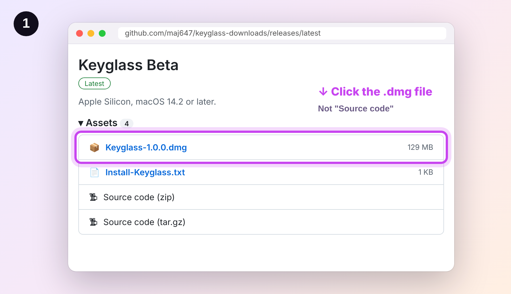
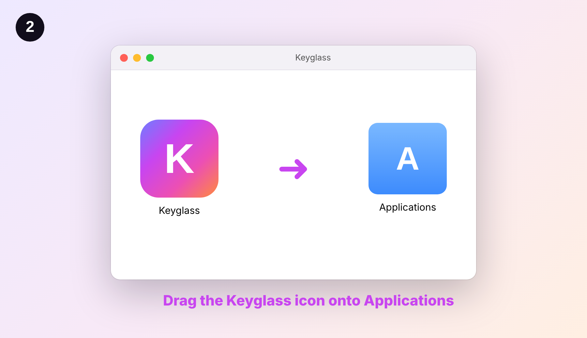
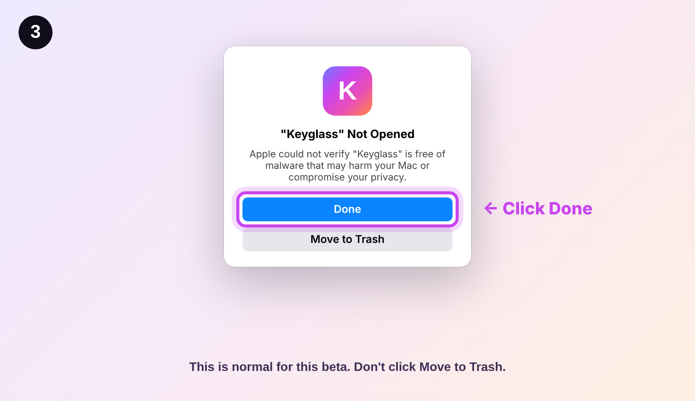
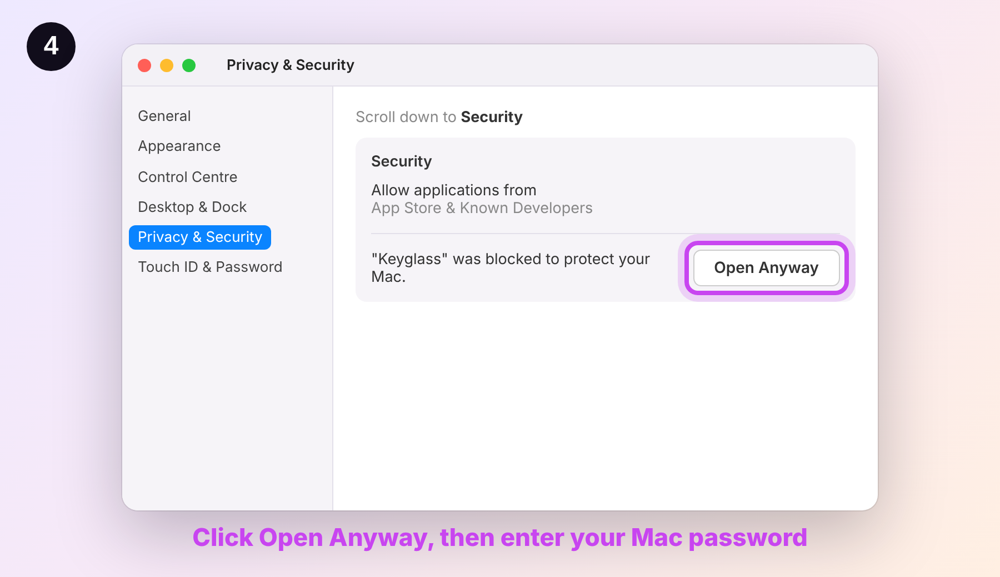

# How to download and install Keyglass

Never used GitHub? No problem. You don't need an account, and you don't need to understand GitHub.
It takes about 2 minutes.

**You need:** a Mac with Apple Silicon (M1 or newer) on macOS 14.2 or later.
Not sure? Click the Apple menu  > **About This Mac**. If it says "Chip: Apple M1" (or M2, M3, M4, M5), you're good.

---

## Step 1: Download the file

**[👉 Click here to open the download page](https://github.com/maj647/keyglass-downloads/releases/latest)**

Scroll down to **Assets** and click the file that ends in **.dmg** (for example `Keyglass-1.0.0.dmg`).
It downloads to your **Downloads** folder.

Don't click "Source code". That's not the app.

## Step 2: Put Keyglass in Applications

Open your **Downloads** folder and double-click the `.dmg` file. A window opens.
**Drag the Keyglass icon onto the Applications folder.**

## Step 3: Open it the first time

Open **Applications** and double-click **Keyglass**.

Your Mac will say *"Keyglass" Not Opened*. That's expected: the beta isn't signed with an Apple
developer certificate yet. Click **Done**. (Don't click Move to Trash.)

## Step 4: Allow it (one time only)

1. Click the Apple menu  > **System Settings**.
2. Click **Privacy & Security** in the sidebar.
3. Scroll all the way down to **Security**. You'll see *"Keyglass" was blocked to protect your Mac.*
4. Click **Open Anyway**, then click **Open Anyway** again and enter your Mac password (or use Touch ID).

Keyglass opens. You never have to do this again. 🎉

The first time, Keyglass takes about a minute to get its analyzer ready. After that each beat takes a few seconds.

---

## Getting updates

When a new version comes out, Keyglass shows *"Keyglass x.y is available"* at the top of its window.
Click **Download**, then do Step 2 again (drag it into Applications and choose **Replace**).
Your settings stay.

## Something went wrong?

| What you see | What to do |
| --- | --- |
| The download page shows lots of code | You're on the wrong page. Use the link in Step 1. |
| Nothing happens when I double-click the .dmg | Look in your **Downloads** folder. Make sure the download finished (no ".download" at the end). |
| There's no "Open Anyway" button | Open Keyglass once first (Step 3), then go back to Privacy & Security within an hour. |
| "Keyglass is damaged and can't be opened" | Send a screenshot to the person who shared Keyglass with you. There's a quick fix and we'll walk you through it. |
| It says my Mac isn't supported | Keyglass needs an Apple Silicon Mac (M1 or newer). Intel Macs can't run it. |

Still stuck? Send a screenshot to the person who shared Keyglass with you.
